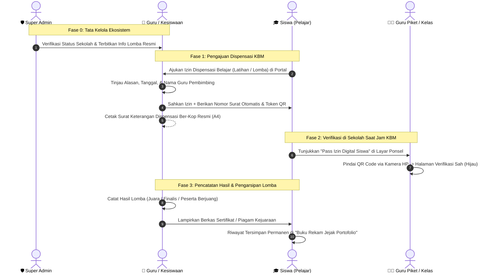

# Panduan Alur Simulasi Penggunaan Sistem PrestasiKu

Dokumen ini berisi panduan skenario uji coba dan simulasi alur kerja (*end-to-end user journey*) sistem **PrestasiKu** untuk seluruh peran pengguna: **Siswa**, **Guru / Admin Kesiswaan Sekolah**, **Guru Piket / Guru Mata Pelajaran (Tanpa Login)**, dan **Super Admin**.

---

## 1. Peta Peran & Kredensial Akun Percobaan (Demo)

Halaman Login: `http://localhost:5173/login`  
*(Tersedia tombol **Uji Coba 1-Click Fill** di bawah formulir login untuk kemudahan simulasi)*

| Peran (Role) | Identitas Login (NIS / Email) | Kata Sandi | Deskripsi & Hak Akses |
| :--- | :--- | :--- | :--- |
| 🎓 **Siswa** | `10101010_2026001` *(atau klik pill Siswa)* | `1234` | Mengajukan izin dispensasi KBM, membuka Pass Digital ber-QR, dan mengakses buku portofolio arsip lomba. |
| 🏫 **Guru / Admin Sekolah** | `admin.sman1@prestasiku.id` *(klik pill Sekolah)* | `password` | Meninjau & menyetujui dispensasi KBM, mencetak surat resmi ber-kop sekolah, mencatat hasil lomba siswa (menang/kalah). |
| 👨‍🏫 **Guru Piket / Guru Kelas** | *Tanpa Login (Akses Terbuka via QR)* | - | Memindai QR code di ponsel siswa untuk memeriksa keabsahan surat tugas dan izin dispensasi saat jam pelajaran. |
| 🛡️ **Super Admin** | `superadmin@prestasiku.id` *(klik pill Admin)* | `password` | Mengelola verifikasi pendaftaran instansi sekolah dan kurasi database kompetisi resmi tingkat nasional/daerah. |

---

## 2. Diagram Alur Kerja Terintegrasi



---

## 3. Skenario Uji 1: Role Siswa (Pengajuan Dispensasi KBM)

### Langkah Simulasi:
1. Buka `http://localhost:5173/login`.
2. Klik tombol demo **`Siswa`** -> klik tombol **`Masuk`**.
3. Sistem akan mengarahkan ke halaman **Buku Saku & Jejak Prestasi Siswa** (`/student/dashboard`).
4. Buka menu navigasi kiri: **OPERASIONAL & KBM** -> **Dispensasi KBM** (`/student/dispensations`).
5. Klik tombol biru **`Ajukan Dispensasi KBM`**.
6. Lengkapi formulir pengajuan:
   - **Nama Kegiatan Lomba**: `Olimpiade Sains Nasional (OSN) Kebumian`
   - **Jenis Dispensasi**: Pilih `Pembinaan & Latihan Intensif` *(atau Pelaksanaan Hari-H)*
   - **Keperluan Izin**: `Bimbingan materi laboratorium dan simulasi soal babak provinsi bersama pembina.`
   - **Periode Tanggal**: Tentukan tanggal mulai dan selesai (misal hari ini atau pekan ini).
   - **Guru Pembimbing**: `Dra. Sri Wahyuni, M.Pd`
   - *(Opsional)* Unggah berkas surat undangan atau poster lomba.
7. Klik **`Kirim Pengajuan`**.
8. Status permohonan Anda kini berstatus **`Menunggu Persetujuan`** dan siap ditindaklanjuti oleh pihak sekolah.

---

## 4. Skenario Uji 2: Role Guru / Admin Sekolah (Persetujuan & Cetak Kop Surat)

### Langkah Simulasi:
1. Logout dari akun siswa, lalu buka kembali `http://localhost:5173/login`.
2. Klik tombol demo **`Sekolah`** -> klik **`Masuk`**.
3. Di **Pusat Operasional Sekolah** (`/school/dashboard`), perhatikan banner pemberitahuan:
   > *"Ada 1 permohonan dispensasi KBM yang menunggu persetujuan dan tanda tangan kesiswaan."*
4. Klik **`Tinjau Sekarang`** atau buka menu **Dispensasi KBM** (`/school/dispensations`).
5. Klik tombol **`Tinjau`** pada permohonan yang diajukan oleh siswa Ahmad Bintang Pratama.
6. Pilih keputusan: **`Setujui Dispensasi`**.
   - Nomor surat dapat diisi manual atau dibiarkan kosong agar sistem menghasilkan penomoran otomatis dinas (contoh: `421.3/001/DISP-SMAN1/2026`).
7. Klik **`Konfirmasi`**. Status surat kini menjadi **`Disahkan`**.
8. **Pratinjau & Cetak Surat Kop Resmi**:
   - Pada baris permohonan yang sudah disahkan, klik tombol **`Cetak Surat`**.
   - Muncul pratinjau dokumen cetak resmi berstandar kedinasan:
     - **Kop Surat Resmi Sekolah** bergaris ganda tipis-tebal.
     - Judul resmi: *SURAT KETERANGAN DISPENSASI BELAJAR (KBM)*.
     - Tabel identitas siswa delegasi (Nama, NIS, Kelas).
     - Alasan izin dan keterangan guru pembina.
     - **Stempel QR Code Validasi** dan kolom tanda tangan Kepala Sekolah/Kesiswaan.
   - Klik **`Cetak Dokumen (PDF)`** bila ingin mencetak fisik atau menyimpan PDF.

---

## 5. Skenario Uji 3: Role Guru Piket / Guru Kelas (Verifikasi QR Tanpa Login)

### Langkah Simulasi:
1. Buka kembali akun Siswa (`10101010_2026001`).
2. Pada **Dashboard Siswa**, perhatikan banner notifikasi hijau:
   > *"Izin Dispensasi KBM Anda Berlaku Hari Ini! — Keperluan: Bimbingan materi laboratorium..."*
3. Klik tombol **`Tunjukkan Pass Digital Guru`**.
4. Muncul kartu digital berdesain modern yang memuat nama siswa, NIS, kelas, dan **QR Code Verifikasi**.
5. **Simulasi Pemindaian oleh Guru**:
   - Guru piket / guru mapel di kelas dapat memindai QR Code tersebut menggunakan kamera smartphone, ATAU
   - Salin tautan verifikasi yang dihasilkan: `http://localhost:5173/verify-dispensation/<token_verifikasi>`.
6. Buka tautan tersebut di jendela penyamaran (*Incognito / Private Window*) untuk membuktikan bahwa guru **tidak perlu login**:
   - Tampil **Sertifikat Verifikasi Dispensasi KBM Resmi** berstatus hijau:
     `SAH & TERVERIFIKASI SISTEM SEKOLAH`.
   - Menampilkan nomor surat tugas, nama pejabat kesiswaan yang mengesahkan, serta batas waktu berlakunya izin di kelas.

---

## 6. Skenario Uji 4: Pencatatan Hasil Lomba (Menang Maupun Kalah)

Sesuai tujuan utama aplikasi, seluruh riwayat keikutsertaan lomba siswa didokumentasikan secara rapi dan bermartabat, baik saat siswa meraih juara maupun saat belum beruntung (sebagai peserta).

### Langkah Simulasi:
1. Masuk ke akun Guru / Admin Sekolah (`admin.sman1@prestasiku.id`).
2. Masuk ke menu **Delegasi & Arsip Lomba** (`/school/registrations`).
3. Pada baris siswa yang bersangkutan, klik tombol **`Catat Hasil`** (berikon medali emas).
4. **Pilihan Hasil 1 (Jika Siswa Meraih Juara)**:
   - *Status Hasil*: Pilih `Juara / Pemenang`
   - *Predikat Peringkat*: Ketik `Juara 2 Tingkat Provinsi`
   - *Berkas*: Unggah berkas piagam penghargaan (PDF / JPG).
   - *Catatan*: `Berhasil lolos seleksi dengan skor teori 88.5.`
5. **Pilihan Hasil 2 (Jika Siswa Kalah / Menambah Jam Terbang)**:
   - *Status Hasil*: Pilih `Peserta / Partisipan (Dokumentasi Pengalaman Berlomba)`
   - *Predikat Peringkat*: Ketik `Peserta Babak Penyisihan Provinsi`
   - *Berkas*: Unggah sertifikat kepesertaan (*Certificate of Participation*).
   - *Catatan*: `Menunjukkan dedikasi tinggi mewakili sekolah.`
6. Klik **`Simpan & Arsipkan`**. Data hasil langsung tersimpan permanen di database sekolah.

---

## 7. Skenario Uji 5: Portofolio Rekam Jejak Siswa

### Langkah Simulasi:
1. Masuk ke akun Siswa (`10101010_2026001`).
2. Buka menu **Buku Rekam Jejak** (`/student/portfolio`).
3. Periksa statistik capaian:
   - **Total Keikutsertaan Lomba**: Merangkum seluruh event yang pernah diikuti.
   - **Prestasi Juara**: Menampilkan kartu medali piala emas.
   - **Pengalaman Peserta**: Menghargai keikutsertaan siswa sebagai modal berharga.
4. Siswa dapat menggunakan tab filter: `Semua Riwayat`, `Juara`, `Finalis`, atau `Peserta Berjuang`.
5. Siswa dapat mengunduh berkas sertifikat atau mengunggah sertifikat mandiri untuk divalidasi kesiswaan sekolah.

---

## 8. Skenario Uji 6: Role Super Admin (Pusat Ekosistem)

### Langkah Simulasi:
1. Masuk ke akun Super Admin (`superadmin@prestasiku.id` / `password`).
2. Anda akan diarahkan ke **Pusat Kendali Ekosistem Nasional** (`/admin/dashboard`).
3. **Verifikasi Sekolah**:
   - Buka menu **Kelola Sekolah** (`/admin/schools`).
   - Admin dapat meninjau NPSN, memeriksa legalitas SK izin operasional, dan menyetujui instansi sekolah baru yang mengajukan registrasi.
4. **Kurasi & Validasi Kompetisi Resmi**:
   - Buka menu **Kelola Kompetisi** (`/admin/competitions`).
   - Admin pusat dapat mempublikasikan lomba resmi (misal dari Puspresnas, Kemendikbudristek, Kemenag, atau universitas ternama).
   - Menetapkan aturan kelayakan (*eligibility rule*): jenjang pendidikan (SLTP / SLTA), batasan tingkatan kelas, dan cakupan wilayah (kabupaten, provinsi, nasional, internasional).

---

## 9. Petunjuk Menjalankan Aplikasi Secara Mandiri

Bila Anda ingin menjalankan aplikasi dari awal di lingkungan lokal Anda:

### Menjalankan Backend (Laravel 12 & PHP 8.4):
```bash
cd backend
php artisan serve --port=8000
```

### Menjalankan Frontend (Vue 3, Vite, TailwindCSS):
```bash
cd frontend
npm run dev
```
Akses antarmuka melalui peramban: `http://localhost:5173`.

### Menjalankan Pengujian Otomatis (PHPUnit Test Suite):
```bash
cd backend
php artisan test
```
*Hasil pengujian saat ini: 54 tests, 232 assertions — 100% Passed.*
